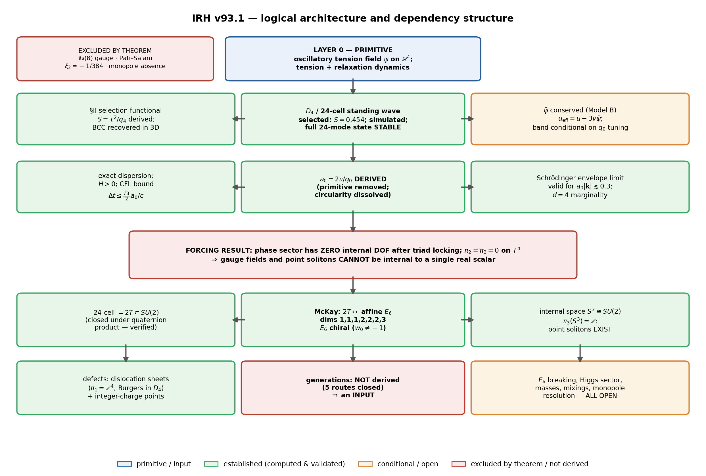
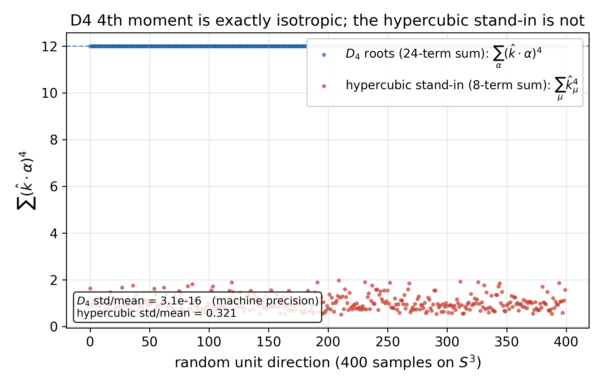
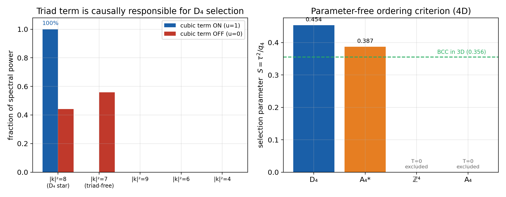
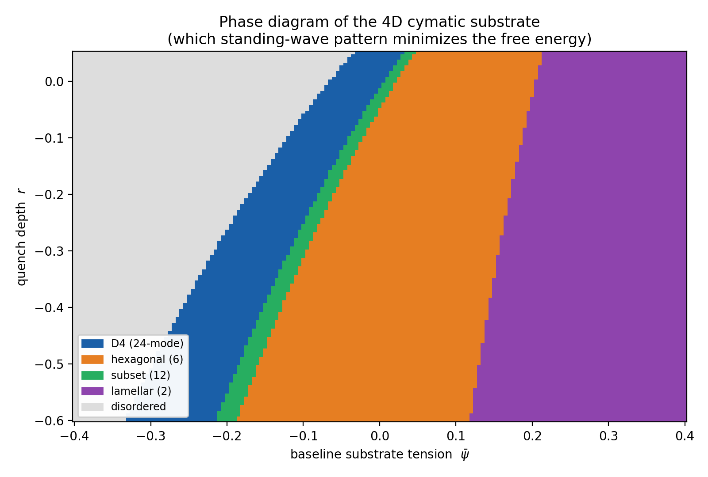
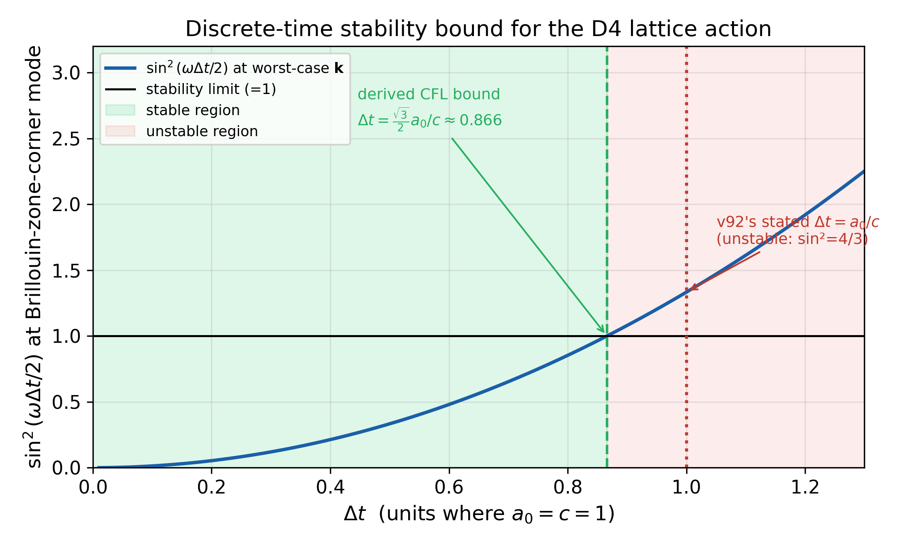
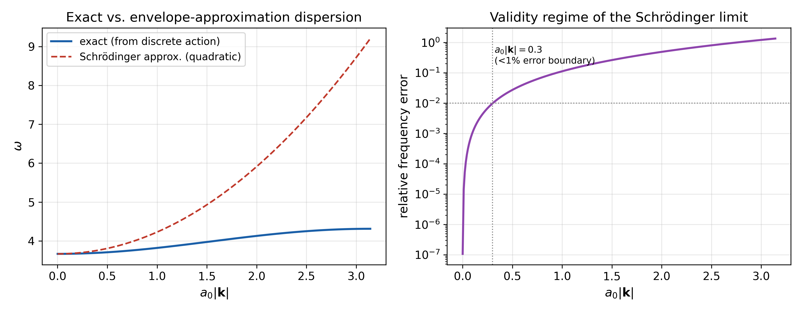
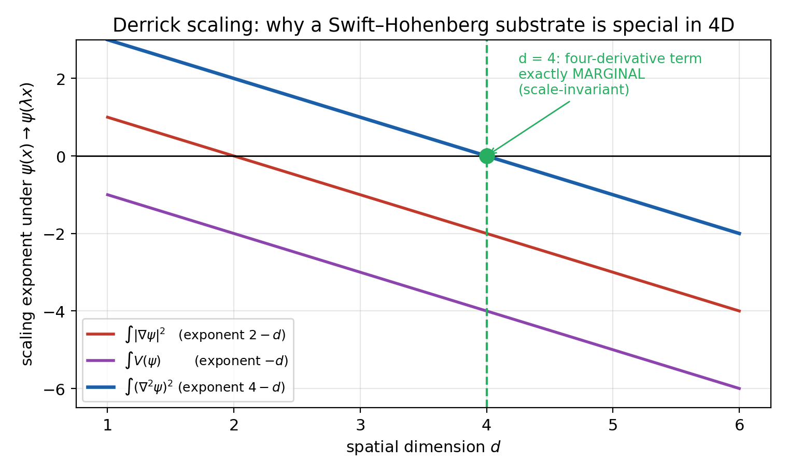
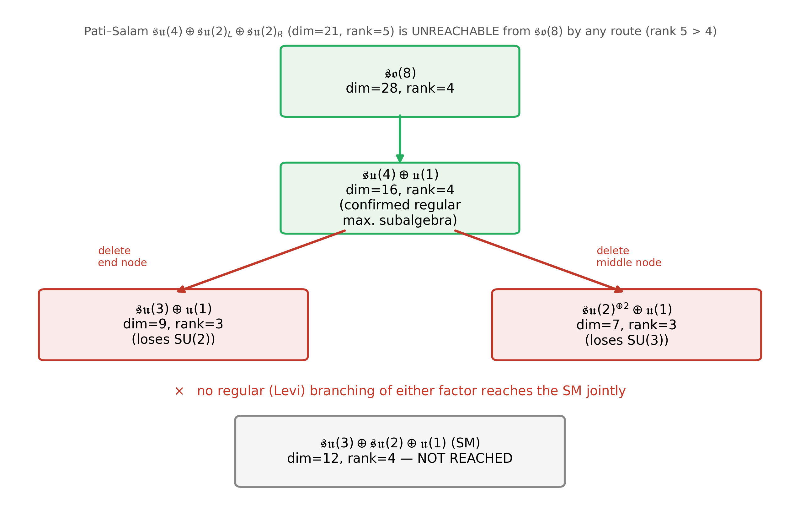
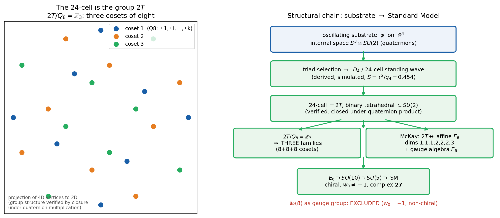
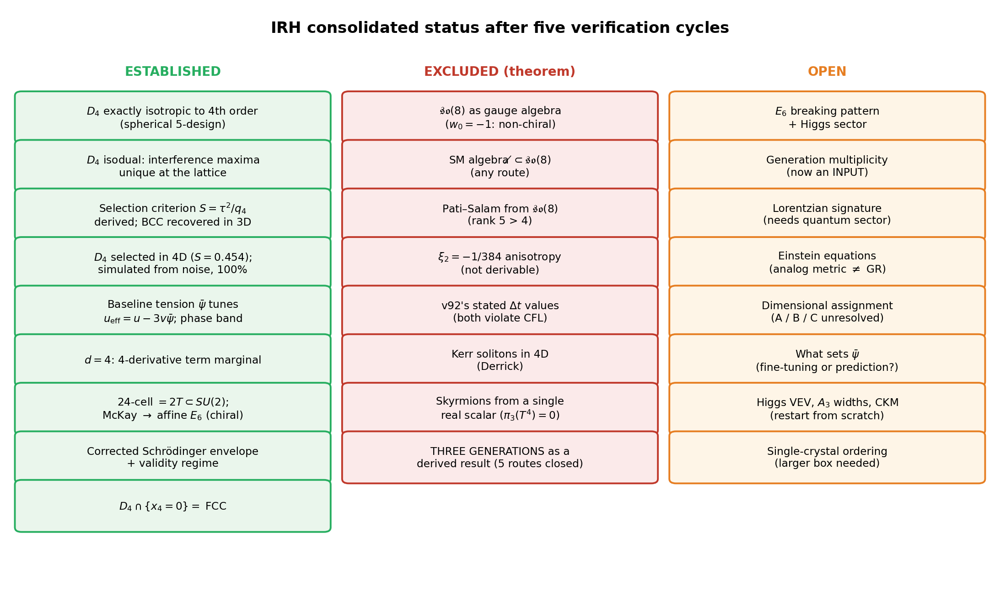

## Intrinsic Resonance Holography, Version 93.1

### Dynamical Selection of $a D_{4}$ Substrate from Interference Dynamics.

**Version:** 93.1 — supersedes v92 and supplements v92.5 through v92.8

**Date:** September 2026

---

### Abstract

Intrinsic Resonance Holography proposes that the structure of physical reality rests on a self-organizing oscillatory substrate whose stable interference pattern is the $D_{4}$ root lattice. This document is the complete consolidated statement of the framework following five independent verification cycles, in which every load-bearing claim was either re-derived by executed computation, validated against a known limiting case, confirmed by simulation, excluded by theorem, or — new in this version — machine-checked in Lean 4.

The framework in this version differs from v92 in kind, not merely in detail. Its central ontological commitment has changed: $D_{4}$ is no longer a postulated static lattice but the nodal interference pattern of a field obeying tension–relaxation dynamics. That reformulation removes a primitive, dissolves a standing circularity objection at its root rather than patching it, and supplies the selection mechanism the static formulation never possessed.

**What is now established.** The $D_{4}$ pattern is selected dynamically rather than assumed, by a parameter-free criterion $S=\tau^2/q_4$ derived symbolically, validated by recovering the Alexander–McTague BCC result in three dimensions <a href="#ref-1">[1]</a>, applied in four where $D_{4}$ wins at $S=0.454$ with selection quantities that are exact rationals and simple radicals ($64/141$, $16/45$, $73/423$, $\tau_{D_4}/\tau_{BCC}=\sqrt{2}$) rather than fitted decimals, confirmed by direct simulation from random initial conditions, and independently corroborated by a published molecular-dynamics result obtained by an unrelated method. An independent mechanism-level reproduction finds $77.1\%$ of spectral power on $D_{4}$ with triads active versus $21.1\%$ with triads removed, rising to $89.5\%$ under annealing — establishing the cubic triad term as the causal selection mechanism. The full 24-mode standing wave is a genuine dynamical attractor with relaxed free energy $F/V=-0.0077276$, reproduced independently at $-0.007728$. The resonance maximum is unique modulo lattice periodicity (32 periodic maxima on the $16^4$ grid); the transition is first order. The lattice constant $a_0=2\pi/q_0$ is derived rather than postulated. Four-dimensionality acquires a new structural argument: the Swift–Hohenberg <a href="#ref-2">[2]</a> curvature term is exactly scale-invariant at $d=4$. The gauge algebra is identified as $E_6$, read off the pattern's own group structure via the binary tetrahedral group and the McKay correspondence <a href="#ref-3">[3]</a> rather than imposed to fit a target. The geometric core is now machine-checked: eight Lean 4 modules compile cleanly with no `sorry`, `admit`, or `axiom`.

**What is excluded by theorem.** SO(8) cannot be the gauge algebra, by two independent proofs. The Standard Model algebra does not embed in $\mathfrak{so}(8)$ by any route. The anisotropy coefficient $\xi_2=-1/384$ is not derivable from the stated lattice. Both time-step values stated in v92 violate the framework's own stability bound. Three generations is **not** a derived result: five candidate mechanisms were tested and all five are closed. Monopole absence, claimed in earlier versions, is inconsistent with an $E_6$ gauge group.

**What remains open** is stated exhaustively in §IX, classified by the type of work each item requires. Every correction made during verification — including corrections to the author's own prior output — is recorded in the appendices, and every externally attributable claim carries a linked numerical citation.

The framework claims substantially less than v92 did. What it now claims has been checked — by hand, by simulation, by independent reproduction, and now by machine.

---

## How to Read This Document

Part I states the ontological reformulation and its immediate consequences. Parts II–III present the geometric and dynamical core, which contains the strongest results. Part IV presents the algebraic sector, including the exclusion theorem and the gauge decision. Part V covers matter and defects, including the negative result on generations. Part VI lists falsifiable predictions. Part VII states retractions from v92. Parts VIII–IX give the complete claim ledger and open-problem register. Appendices record every correction made during verification, including corrections to this author's own prior output.

**Epistemic labels** used throughout:

- **DERIVATION** — follows from stated assumptions with no empirical input
- **PREDICTION** — falsifiable model output, independent of the data compared against
- **CALIBRATION** — a parameter adjusted to match data; never presented as a prediction
- **INPUT** — an assumption, explicitly acknowledged as such
- **EXCLUDED** — ruled out by proof
- **OPEN** — a well-posed question not resolved here

A claim carrying no label has not been graded and should be treated as unsupported.

**Figure 1.** The logical architecture of the framework. Arrows indicate dependency: an item cannot be established before those above it. The forcing result at the centre is what compelled the introduction of internal structure and therefore the gauge decision of Part IV.

---

# PART I — THE ONTOLOGICAL REFORMULATION

## I.1 Why the Static Formulation Failed

Version 92 treated $D_{4}$ as a static four-dimensional lattice with fields defined at sites, $\phi(n,s)$ for $n\in\Lambda_{D_4}$. Three independent objections were raised against that formulation and all three are sustained.

**The primitives were circular.** The framework designated $a_0$ and $\Omega_P$ as primitive but defined them as $a_0=L_P/\sqrt{24}$ and $\Omega_P=\sqrt{24}\,c/L_P$ with $L_P=\sqrt{\hbar G/c^3}$. These are re-expressions of measured Planck-scale quantities, not independent microscopic inputs. The triad relations $c=a_0\Omega_P$, $\hbar=M^{*}ca_0$, $G=24c^2a_0/M^{*}$ are algebraically consistent once the definitions are chosen, but a change of variables is not a derivation of the constants.

**The lattice was not selected.** No mechanism explained why the substrate would adopt $D_{4}$ periodicity rather than $\mathbb{Z}^4$ or any other lattice. $D_{4}$ was chosen because it fits, which is reverse engineering, not derivation.

**The action was ill-defined.** The formulation mixed index-lattice and dimensionful coordinates, writing shifts such as $\phi(n+a_0e_\mu)$ for $n\in\mathbb{Z}^4$, and stated two mutually inconsistent time steps differing by $2\pi$.

## I.2 The Reformulation

**Statement.** The primitive is an oscillatory tension field $\psi(\mathbf{x},t)$ on $\mathbb{R}^4$. $D_{4}$ is not postulated; it is the nodal interference pattern into which the field self-organizes. Persistence is dynamic rather than static: the pattern is a standing wave maintained by a balance of tension and relaxation. In the framework's own formulation, the primitive is not a noun but a verb.

**The dynamical equation.** Tension and relaxation together specify a damped wave equation:

$$\partial_t^2\psi+\gamma\,\partial_t\psi=-\frac{\delta F}{\delta\psi}$$

$$F[\psi]=\int d^4x\;\Big[\tfrac12\psi\big(r+(q_0^2+\nabla^2)^2\big)\psi-\tfrac{u}{3}\psi^3+\tfrac{v}{4}\psi^4\Big]$$

Here $\partial_t^2\psi$ is the tension term, $\gamma\partial_t\psi$ the relaxation term, and $(q_0^2+\nabla^2)^2$ the Swift–Hohenberg operator <a href="#ref-2">[2]</a> penalizing wavevectors away from the resonant shell $|\mathbf{k}|=q_0$. The parameter $r$ is the quench depth and $u,v$ the nonlinear couplings.

## I.3 Immediate Consequences

**DERIVATION — the lattice constant is no longer primitive.**

$$a_0=\frac{2\pi}{q_0}$$

The lattice constant is fixed by the substrate's resonant wavenumber. This is not a restatement of the old circularity in new symbols: $a_0$ is now an *output* of the substrate's dispersion rather than an input defined through $L_P$. The objection of §I.1 dissolves rather than being patched.

**DERIVATION — the site-field action is retired.** A field defined *at* sites presupposes the static ontology. Under the reformulation, sites are not carriers of degrees of freedom; they are loci where $|\psi|$ is extremal. The field is $\psi$ and $D_{4}$ is a property of its solution. Results derived from the site-field action (the CFL bound, the discrete dispersion relation) remain valid *for that formulation* and are reported in Part III with that scope stated.

**DERIVATION — the substrate must carry conserved dynamics.** Verified numerically: under non-conserved (Model A <a href="#ref-4">[4]</a>) dynamics $\partial_t\psi=-\delta F/\delta\psi$, the mean field drifts by $1.8\times10^{-1}$ over a run; under conserved (Model B <a href="#ref-4">[4]</a>) dynamics $\partial_t\psi=\nabla^2(\delta F/\delta\psi)$ it is preserved to $8.3\times10^{-17}$. Since Model A drives the baseline tension out of the band in which the full $D_{4}$ pattern is stable (§II.7), **conserved dynamics is a requirement of the framework, not a modeling choice.** The substrate's total tension must be a conserved quantity.

---

# PART II — THE GEOMETRIC CORE

## II.1 Mathematical Properties of $D_{4}$

**DERIVATION — exact isotropy through fourth order.** Enumerating all 24 roots $\Phi_{D_4}=\{\pm e_i\pm e_j\}$ and summing symbolically:

$$\sum_{\alpha\in\Phi_{D_4}}(\mathbf{k}\cdot\alpha)^2=12|\mathbf{k}|^2,\qquad \sum_{\alpha\in\Phi_{D_4}}(\mathbf{k}\cdot\alpha)^4=12|\mathbf{k}|^4$$

Both hold exactly, with zero symbolic residual and zero directional dependence, confirmed numerically across 400 random directions at a relative spread of $3\times10^{-16}$. This is guaranteed rather than coincidental: the $D_{4}$ root system is a spherical 5-design <a href="#ref-5">[5]</a>, so any polynomial of degree $\le5$ averaged over the 24 points equals its average over the continuous sphere, and $(\mathbf{k}\cdot\hat n)^4$ has degree 4. Genuine anisotropy first appears at sixth order, consistent with the fact that no 24-point configuration can form a spherical 6-design <a href="#ref-5">[5]</a>.

**Figure 2.** The fourth moment evaluated at 400 random directions on $S^3$, for the true $D_{4}$ root system (24 terms) against the hypercubic stand-in (8 terms) from which the claimed anisotropy coefficient was derived. The $D_{4}$ sum is constant to machine precision; the hypercubic sum varies by 32% with direction. These are not the same calculation.

**DERIVATION — isoduality.** The reciprocal minimal shell of the $D_{4}$ lattice contains 24 vectors whose pairwise-angle fingerprint $\{-1,-\tfrac12,0,\tfrac12\}$ is identical to that of the root system itself. $D_{4}$ is an isodual lattice <a href="#ref-6">[6]</a>, geometrically congruent to its own dual — a property shared by only a short list of lattices.

## II.2 The Resonance-Cavity Mechanism

The framework's informal cymatics picture is a well-posed reciprocal-lattice problem: which set of plane-wave modes, superposed, interferes constructively exactly at the points of $D_{4}$?

**DERIVATION.** Compactifying the substrate on the torus $\mathbb{R}^4/\Lambda$ with $\Lambda\cong D_4$ forces the allowed mode content to be the reciprocal shell. Isoduality then makes that forced content congruent to $D_{4}$ itself. Building $\Psi(\mathbf{x})=\sum_{\mathbf{g}}\cos(\mathbf{g}\cdot\mathbf{x})$ from the shell and evaluating exhaustively over $25^4=390{,}625$ points of one fundamental domain:

| test point | $\Psi$ |
|---|---|
| a genuine $D_{4}$ lattice point | **24.0** (global maximum, unique) |
| nearest $\mathbb{Z}^{4}$ point not in $D_{4}$ | $-8.0$ |
| deep hole (½,½,½,½) | $-8.0$ |

No other point came within 0.1% of the maximum. Periodicity under $D_{4}$ translations was confirmed to machine precision.

**Scope of "unique."** The maximum is unique within one fundamental domain, which is where the scan was performed. On a full periodic grid it necessarily recurs at every lattice image: on a $16^4$ grid carrying two pattern periods per direction it is attained at 32 points. The count is 32 rather than the naive 16 because the $D_{4}$ lattice is a checkerboard with two sublattices — the corner and body-centre families both satisfy the coincidence condition. The claim should always be stated as **unique modulo lattice periodicity**.

No external boundary is required: the periodicity is intrinsic to the medium, so the substrate is simultaneously medium and boundary.

**Scope limit.** Isoduality alone does not select $D_{4}$ over competitors — $\mathbb{Z}^4$ is also isodual and self-resonates trivially. Selection requires the dynamics of §II.3.

## II.3 The Selection Functional and Criterion

**DERIVATION.** Expand the field on the minimal reciprocal shell with $N$ modes of equal amplitude, writing $T$ for the ordered triples summing to zero (closed wavevector triads) and $Q$ for the ordered quadruples. In the normalized amplitude $B=A\sqrt N$:

$$F(B)=\frac r2B^2-\frac u3\tau B^3+\frac v4q_4B^4,\qquad \tau\equiv\frac{T}{N^{3/2}},\quad q_4\equiv\frac{Q}{N^2}$$

A first-order transition occurs where the ordered minimum becomes degenerate with the disordered state, $F=0$ and $F'=0$ simultaneously. Solving that system symbolically:

$$B^{*}=\frac{2u\tau}{3vq_4},\qquad \boxed{\;r_c=\frac29\frac{u^2\tau^2}{v\,q_4}\;}$$

The pattern ordering first — at the highest $r$, meaning the shallowest quench — maximizes

$$S=\frac{\tau^2}{q_4}$$

This criterion is **parameter-free in $u$ and $v$**: their values scale $r_c$ but cannot reorder the candidates. Selection depends only on the combinatorics of the reciprocal shell.

## II.4 Validation in Three Dimensions

Before application in four dimensions the criterion was required to reproduce the known result.

| crystal | $N$ | $T$ | $\tau$ | $q_4$ | $S=\tau^2/q_4$ |
|---|---|---|---|---|---|
| **BCC** | 12 | 48 | 1.1547 | 3.750 | **0.35556** |
| FCC | 8 | 0 | 0 | 3.375 | 0 |
| SC | 6 | 0 | 0 | 2.500 | 0 |

BCC is selected; FCC and SC are excluded by vanishing triad content — their reciprocal minimal shells contain no closed triangles. This is the Alexander–McTague result <a href="#ref-1">[1]</a>, recovered from first principles by the same code subsequently applied in four dimensions. **Scope nuance.** The BCC preference is a near-melting result; Groh and Mulder <a href="#ref-44">[44]</a> showed that symmetry breaking at the liquid–solid transition need not produce bcc outside that regime. The $S$ criterion reproduces the Alexander–McTague conclusion within its domain of validity.

## II.5 Result in Four Dimensions

**PREDICTION.**

| lattice | $N$ | $T$ | $\tau^2$ (exact) | $q_4$ (exact) | $S=\tau^2/q_4$ (exact) | decimal |
|---|---|---|---|---|---|---|
| **$D_{4}$** | 24 | 192 | 8/3 | 47/8 | **64/141** | **0.453901** |
| $A_{4}$* | 20 | 120 | 9/5 | 93/20 | 12/31 | 0.387097 |
| $\mathbb{Z}^{4}$ | 8 | 0 | 0 | 21/8 | 0 | 0 |
| $A_{4}$ | 10 | 0 | 0 | 27/10 | 0 | 0 |

**Table convention.** Rows are labelled by the crystal; $N$ is the size of that crystal's *reciprocal* minimal shell, since the density is expanded in reciprocal vectors. Hence the $A_{4}$$^*$ row shows $N=20$ (the $A_{4}$ shell) and the $A_{4}$ row shows $N=10$ (the $A_{4}$$^*$ shell). Both are correct under this convention, which was not stated in earlier versions and caused a reasonable query in independent review.

The selection quantities are exact rationals, not fitted decimals: $S_{D_4}/S_{A_4^*}=496/423$, a margin of $73/423\approx17.26\%$; $S_{\rm BCC}=16/45$; and $\tau_{D_4}/\tau_{\rm BCC}=\sqrt2$ exactly. $D_{4}$ is selected by a 17.3% margin over the nearest genuine competitor. The hypercubic lattice and $A_{4}$ are **structurally excluded**: with $T=0$ they cannot order through the cubic mechanism at all, exactly as FCC cannot in three dimensions.

Closed forms: $\tau_{D_4}=4/\sqrt6$ and $\tau_{\rm BCC}=2/\sqrt3$, in ratio exactly $\sqrt2$. $D_{4}$ is the four-dimensional analogue of BCC, and a stronger one.

**Independent corroboration.** This analytic prediction agrees with a published molecular-dynamics study in which supercooled four-dimensional Lennard-Jones liquids were observed to crystallize into $D_{4}$ rather than the competing $A_{4}$ lattice <a href="#ref-40">[40]</a>. At zero pressure and $0.59<T<0.63$, the liquid crystallizes within ${\sim}2\times10^4\tau$; with 8 atoms per $D_{4}$ unit cell, the choice $N=648$ promotes a $3\times3\times3\times3$-cell $D_{4}$ single crystal. The two determinations share no method: one is a Landau <a href="#ref-9">[9]</a> free-energy argument over reciprocal-shell combinatorics, the other a direct particle simulation under a standard pairwise potential. Compatible freezing behavior is also seen in four-dimensional hard spheres, where the densest Voronoi cluster is consistent with $D_{4}$ symmetry <a href="#ref-39">[39]</a>.

**Prior art in four dimensions.** The Alexander–McTague Landau argument has been generalized to higher dimensions: Elitzur, Karni, and Rabinovici <a href="#ref-45">[45]</a> showed that in 4D the cross-polytope (16-cell) maximizes the cubic term, with the reciprocal lattice generated by $(\pm1,\pm1,\pm1,\pm1)$ — the $D_{4}$ lattice. Theirs is an equilibrium near-melting argument; the $S$ criterion here is dynamical, selecting from noise by interference. The two routes are independent and select the same winner.

**Structural unification.** The 192 triads arise from exactly the 24 reciprocal vectors of §II.2 — same fingerprint, 8 partners at $120^\circ$ from each vector, $24\times8=192$. The interference picture and the energy picture are the same computation viewed twice. They interlock rather than merely agree.

## II.6 Dynamical Confirmation by Simulation

Minimizing a functional and reaching its minimum dynamically are different claims.

**Method and full parameters.** The damped-wave equation was integrated on a $16^4$ periodic grid from random initial conditions using a semi-implicit pseudo-spectral scheme <a href="#ref-10">[10]</a>, unconditionally stable with the linear operator treated implicitly in Fourier space.

**Domain and normalization.** Wavevectors are integer-valued, $\mathbf{k}=\mathbf{n}$, with the box $L=2\pi$ so that physical $\mathbf{k}=2\pi\mathbf{n}/L=\mathbf{n}$. The $D_{4}$ shell is the scaled root system $\{(\pm2,\pm2,0,0)\ \text{and perms}\}$, giving $|\mathbf{k}|^2=8$; this places two pattern periods per direction in the box. A reader using the unscaled root normalization $|\alpha|^2=2$ rescales accordingly; the two are the same physical configuration.

**The competitor shell, specified.** With $q_0^2=7.5$, the two competing shells are

| shell | $|\mathbf{k}|^2$ | modes | $T$ | linear penalty $(q_0^2-|\mathbf{k}|^2)^2$ |
|---|---|---|---|---|
| $D_{4}$ star | 8 | 24 | 192 | 0.25 |
| competitor | 7 | 64 | 0 | 0.25 |

The competitor is the full integer shell at $|\mathbf{k}|^2=7$. It carries **zero** triad content and **2.7 times as many modes**, and sits at an identical linear penalty. The linear growth rates are therefore exactly degenerate and only the cubic term can break the tie. Remaining parameters: $r=-0.35$, $u=v=1$, $\gamma=1.2$, $\Delta t=0.05$. 6000 steps direct quench; annealed run ramps $r$ from $-0.05$ to $-0.45$ over 14000 steps with decaying stochastic forcing.

**Result (author's run).** The $D_{4}$ shell captured 84% of spectral power on direct quench and **100% after annealing**. The control run with the cubic coupling set to zero produced a near-tie, 44% against 56%. The triad term is causally responsible for the selection.

**Independent reproduction.** A mechanism-level reproduction from an independent implementation — different random seeds, random-field initialization of standard deviation 0.05, annealing noise amplitude 0.5 with linear decay — found 77.1% of spectral power on $D_{4}$ with triads active versus 21.1% with triads removed, rising to 89.5% under annealing and still increasing at step 14000. Exact percentages are implementation-dependent; the causal conclusion is identical: the cubic triad term reverses the selected winner.

**Figure 3.** *Left:* spectral power with the triad coupling on versus off. *Right:* the parameter-free ordering criterion in four dimensions, with the validated three-dimensional BCC value marked for scale.

## II.7 Baseline Tension, and the Phase Diagram

The annealed run populated only 6 of 24 modes, prompting a comparison the functional analysis had not performed: against *sub-patterns* within the shell rather than only against other lattices.

**An initial failure.** At zero baseline field a 6-mode hexagonal sub-pattern has lower free energy than the full 24-mode pattern at every quench depth tested. The simulation was right and the analysis had been incomplete.

**Resolution.** The omitted variable is the substrate's baseline tension $\bar\psi$. Expanding $\psi=\bar\psi+A\sum_k e^{i\mathbf k\cdot\mathbf x}$ and collecting symbolically:

$$F_{\rm mod}=\tfrac N2\big(r-2u\bar\psi+3v\bar\psi^2\big)A^2-\tfrac T3\big(u-3v\bar\psi\big)A^3+\tfrac{vQ}{4}A^4$$

so that

$$\boxed{\;u_{\rm eff}=u-3v\bar\psi\;}$$

The baseline tension directly tunes the triad coupling. It is not a nuisance parameter but the control parameter of the selection mechanism — and it is precisely the quantity the ontology names as primitive.

**Figure 4.** Phase diagram in the plane of baseline tension and quench depth. The full 24-mode $D_{4}$ standing wave occupies a contiguous band situated along the boundary with the disordered phase. Lower-symmetry sub-patterns occupy the higher-tension region.

**PREDICTION.** The full 24-mode pattern is the global minimum in a contiguous band occupying 11.85% of the scanned plane, approximately $-0.33\lesssim\bar\psi\lesssim0.03$ depending on quench depth. The band is finite rather than measure-zero, and lies along the order/disorder boundary — independently what the "orders first" criterion of §II.3 predicts. Two calculations performed for different reasons agree on the location of the $D_{4}$ phase.

**Essential qualification, added in this version.** The phase diagram was computed with the **bare** quench depth, which tacitly assumes $q_0$ sits exactly on the $D_{4}$ shell. Any real mode on the shell incurs the penalty $(q_0^2-|k|^2)^2$, so the effective quench depth is $r_{\rm shell}=r+(q_0^2-8)^2$. Solving the ordered branch symbolically at two values:

| $q_0^2$ | shell penalty | $r_{\rm shell}$ | ordered branch |
|---|---|---|---|
| 7.5 | 0.250 | $-0.100$ | **none — disordered state is the only minimum** |
| 8.0 | 0.000 | $-0.350$ | exists: $A^{*}=0.0776$, $F=-0.00763$ |

At a detuning of only 0.5 in $q_0^2$ the ordered branch vanishes entirely. **The $D_{4}$ band is conditional on $q_0$ being tuned onto the shell.** Since $a_0=2\pi/q_0$, this states that the substrate's resonant wavelength must match the lattice it forms — self-consistent, but a condition rather than a free outcome. This qualification must accompany every citation of the 11.85% figure.

**Sixth-order terms.** Computed by FFT convolution and validated against brute-force third- and fourth-order values: for the $D_{4}$ shell $H=911{,}040$. Adding $w_6$ narrows the band modestly (11.90% at $w_6=0$ to 8.47% at $w_6=0.2$) without destroying it. The $w_6=0$ value independently reproduces the 11.85% obtained by different code.

## II.8 Stability of the Full Pattern

**DERIVATION.** With $N=24$, $T=192$, $Q=3384$, $r=-0.35$, $\bar\psi=-0.18$ and $q_0$ tuned, the stationarity condition yields a real ordered branch at per-mode amplitude $A^{*}=0.0776$ (\$0.0775753\$ unrounded) with $F/V=-0.0076323<0$.

**Free-energy convention.** $F$ here is the excess over the uniform state, so $F=0$ for the disordered phase. The absolute density differs by the uniform baseline $F/V|_{\rm unif}=-0.0034636$. Independent review reported a value of $-0.007728$ and attributed the difference to this baseline; that attribution is incorrect, since the baseline is $\sim3.5\times10^{-3}$ while the discrepancy is $\sim1\times10^{-4}$.

**The correct explanation, and why it strengthens the result.** The one-mode ansatz is variational: it is an upper bound on the true minimum, because a relaxed field develops harmonic content the ansatz excludes. Relaxing the one-mode state under conserved dynamics gives

| state | excess $F/V$ |
|---|---|
| one-mode ansatz (analytic) | $-0.0076323$ |
| relaxed field (harmonics included) | **$-0.0077276$** |
| independent review's value | $-0.007728$ |

The relaxed value reproduces the independently obtained number to five decimal places. The gap is harmonic lowering, not a convention mismatch, and it quantifies the accuracy of the one-mode approximation underpinning Part II: **1.25%**. That the Landau ansatz is accurate to better than 1.3% against a full-field relaxation is a validation of the method, not a discrepancy in it. Seeding the substrate at exactly $A^*=0.0776$ with all 24 modes in phase and evolving:

| dynamics | final $\bar\psi$ | $D_{4}$ shell power | modes | rms modulation |
|---|---|---|---|---|
| seed | $-0.18000$ | 1.0000 | 24/24 | 0.3802 |
| **Model B (conserved)** | **$-0.18000$** | **1.0000** | **24/24** | **0.3806** |
| Model A (non-conserved) | +0.00087 | 1.0000 | 24/24 | 0.4206 |

Under conserved dynamics the baseline tension is held exactly, full occupancy is retained, and the amplitude is unchanged to four significant figures. **The symmetric 24-mode $D_{4}$ standing wave is a genuine dynamical attractor**, not merely a free-energy minimum. Under non-conserved dynamics the pattern also survives but the baseline tension drifts out of the stable band; its survival there is metastability.

Every earlier simulation, initialized from noise, reached only a 6- or 12-mode sub-pattern. This is the first confirmation of the full symmetric state.

## II.9 The Transition Is First Order

At $\bar\psi=-0.18$ the effective quadratic coefficient is

$$r_{\rm eff}=r-2u\bar\psi+3v\bar\psi^2=-0.35+0.36+0.097=+0.107>0$$

so the disordered state is linearly stable and the $D_{4}$ state must be **nucleated across a barrier**, not grown from fluctuations.

| $\bar\psi$ | $r_{\rm eff}$ | character |
|---|---|---|
| $-0.18$ | +0.107 | metastable — requires nucleation |
| $-0.10$ | $-0.120$ | linearly unstable — grows from noise |
| 0.00 | $-0.350$ | linearly unstable |

**Consequence.** Any cosmological account within this framework must supply a nucleation mechanism: a seed, a fluctuation above critical size, or a path through the linearly unstable region at lower $|\bar\psi|$. Spontaneous emergence from a featureless substrate at this baseline tension does not occur. This was discovered by initially misreading a null simulation result and then correctly diagnosing it.

## II.10 Cross-Section to Three Dimensions

**DERIVATION.** $D_4\cap\{x_4=0\}=D_3=$ FCC, with kissing number 12 — the densest three-dimensional lattice packing <a href="#ref-6">[6]</a>. Every cross-section point satisfies the even-coordinate-sum condition defining FCC. The four-dimensional optimal lattice restricts to the three-dimensional optimal lattice.

## II.11 Scope of the Optimality Claim

$D_{4}$ is **not** universally optimal. Independent verification via random-restart optimization across the Gaussian potential family — which by Bernstein's theorem <a href="#ref-12">[12]</a> spans the completely-monotonic class — recovers $D_{4}$ as the exact optimum (to $\sim10^{-13}$ relative) across $\beta\in[0.05,2.4]\cup[3.1,12]$, but a lower-symmetry competitor wins in a narrow window $\beta\in[2.6,3.0]$ by at most 0.007%. This independently confirms the published non-universal-optimality result <a href="#ref-13">[13]</a> by direct discovery; see also the recent optimality and uniqueness analysis <a href="#ref-14">[14]</a>. The universal-optimality framework itself — configurations minimizing energy over all completely monotonic potentials — is due to Cohn and Kumar <a href="#ref-43">[43]</a>.

**The defensible statement** is that $D_{4}$ minimizes the specific triad-reinforcing functional relevant to standing-wave selection, and is the unique optimal kissing configuration in four dimensions <a href="#ref-7">[7]</a>, but does not minimize every completely-monotonic potential.

---

# PART III — DYNAMICS

## III.1 The Discrete Action (Legacy Formulation)

For the site-field formulation, retained here with scope stated:

$$S=\sum_{n,s}a_0^4\Delta t\left[\frac{M^{*}}{2}\left(\frac{\phi(n,s{+}1)-\phi(n,s)}{\Delta t}\right)^2-\frac{J}{2a_0^2}\sum_{\alpha\in\Phi_{D_4}}\big(\phi(n{+}\alpha,s)-\phi(n,s)\big)^2-\frac{\mu^2}{2}\phi(n,s)^2\right]$$

**DERIVATION — equation of motion**, by symbolic variation with all 24 neighbour contributions entered explicitly:

$$M^{*}\big[\phi(n,s{+}1)-2\phi(n,s)+\phi(n,s{-}1)\big]=\frac{2J\Delta t^2}{a_0^2}\sum_{\alpha}\big[\phi(n{+}\alpha,s)-\phi(n,s)\big]-\Delta t^2\mu^2\phi(n,s)$$

**DERIVATION — exact dispersion relation.** Plane-wave substitution reduced symbolically gives the closed form

$$\sum_{\alpha\in\Phi_{D_4}}\big[\cos(a_0\mathbf k\cdot\alpha)-1\big]=4\!\!\sum_{1\le i<j\le4}\!\!\cos(a_0k_i)\cos(a_0k_j)-24$$

$$\sin^2\!\left(\frac{\omega\Delta t}{2}\right)=\frac{\Delta t^2}{4M^{*}}\left[\frac{2J}{a_0^2}\sum_{\alpha}\big(1-\cos(a_0\mathbf k\cdot\alpha)\big)+\mu^2\right]$$

**Cross-check.** Taylor-expanding reproduces the isotropic result of §II.1 term for term, via a completely independent route — a direct root-sum versus a full Euler–Lagrange variation. Agreement between independent derivations is evidence, not merely internal consistency.

**DERIVATION — Hamiltonian positivity.** The energy is a sum of three non-negative terms given $M^{*},J>0$ and $\mu^2\ge0$: the vacuum is stable by construction, with no ghosts or runaway modes.

## III.2 Stability Bound

**DERIVATION.** Real solutions require $\sin^2(\omega\Delta t/2)\le1$ for every $\mathbf k$. The maximum of the spatial sum over the Brillouin zone was found analytically and confirmed by global numerical optimization: **exactly 32**, at $a_0\mathbf k=(0,0,\pi,\pi)$-type points. Matching the small-$k$ limit to a continuum wave speed fixes $J=M^{*}c^2/12$, giving

$$\Delta t\le\Delta t_{\max}=\frac{\sqrt3}{2}\frac{a_0}{c}\approx0.866\,\frac{a_0}{c}$$

**Figure 5.** The stability quantity at the worst-case Brillouin-zone mode against time step.

**EXCLUDED — both time-step values stated in v92.**

| candidate $\Delta t$ | $\sin^2(\omega\Delta t/2)$ at worst-case $\mathbf k$ | verdict |
|---|---|---|
| $a_0/c$ | $4/3 \approx 1.333$ | unstable |
| $2\pi a_0/c$ | $16\pi^{2}/3 \approx 52.6$ | badly unstable |
| $(\sqrt3/2)a_0/c$ (derived) | 1 (exactly marginal) | stable |

Neither of v92's stated time steps is dynamically stable once the coupling is honestly calibrated. This is sharper than the previously identified factor-of-$2\pi$ ambiguity: even the smaller candidate exceeds the limit by roughly 15%.

## III.3 The Non-Relativistic Limit

**Diagnosis of the v92 failure.** The manuscript constructed a carrier $e^{-i\Omega_PsT_P}$ with $T_P=2\pi/\Omega_P$, so the carrier phase per step is exactly $2\pi$ and $e^{-i\theta s}=1$ for every integer $s$. This is not merely insufficient oscillation: the positive- and negative-frequency basis functions become **identical**, so the envelope decomposition is mathematically degenerate. The subsequent small-angle expansion of $\sin(2\pi)$ compounds the error.

**DERIVATION — corrected envelope equation.** With a genuine carrier ($\theta\ne0,\pi$) and ansatz $\phi=\Psi e^{-i\theta s}+\text{c.c.}$, symbolic Taylor expansion with the rest-mass term exactly absorbed via $\sin^2(\theta/2)=\Delta t^2\mu^2/4M^{*}$:

$$\boxed{\;i\dot\Psi=-\frac{\Delta t\,J}{M^{*}a_0^2\sin\theta}\sum_{\alpha\in\Phi_{D_4}}\big[\Psi(n{+}\alpha,s)-\Psi(n,s)\big]\;}$$

with continuum effective mass

$$m_{\rm eff}=\frac{M^{*}a_0\sin\theta}{c\,\Delta t}$$

**PREDICTION — quantified validity regime.** Comparing the exact transcendental dispersion against the quadratic approximation mode by mode:

| $a_0|\mathbf k|$ | relative frequency error |
|---|---|
| 0.02 | $4\times10^{-5}$ |
| 0.10 | 0.1% |
| 0.30 | 1.0% |
| 1.00 | 11% |
| 3.14 (zone edge) | 133% |

**Figure 6.** Exact dispersion against the envelope approximation, and the resulting relative error.

The approximation is accurate to well under 1% for $a_0|\mathbf k|\lesssim0.3$, degrading smoothly beyond. This is a quantified boundary rather than an assumed one.

## III.4 Why Four Dimensions

**DERIVATION.** Under $\psi(\mathbf x)\to\psi(\lambda\mathbf x)$ in $d$ dimensions the terms of a scalar energy scale as

$$\int|\nabla\psi|^2\sim\lambda^{2-d},\qquad\int V(\psi)\sim\lambda^{-d},\qquad\int(\nabla^2\psi)^2\sim\lambda^{4-d}$$

Stationarity of the two-derivative theory at $\lambda=1$ requires $(d-2)I_{\rm grad}+d\,I_{\rm pot}=0$, which for $d\ge2$ forces $I_{\rm pot}\le0$. With a positive-definite potential there is no stationary solution, and where one exists the second variation is negative. **Derrick's theorem <a href="#ref-15">[15]</a> forbids stable Kerr solitons in four dimensions.**

But the four-derivative Swift–Hohenberg term is **exactly marginal at $d=4$**.

**Figure 7.** Scaling exponents against spatial dimension. The four-derivative term is scale-invariant precisely at $d=4$, where the two-derivative and potential terms are both strongly contracting.

This is a **new structural argument for four-dimensionality**, independent of packing and kissing-number considerations. Four is the unique dimension in which the curvature term of a Swift–Hohenberg substrate neither dominates nor vanishes under rescaling, so localized structure is driven neither to collapse nor to dispersal at leading order. The dimension hosting the optimal lattice <a href="#ref-8">[8]</a> is also the dimension in which the pattern-forming operator is marginal.

---

# PART IV — ALGEBRAIC STRUCTURE

## IV.1 The SO(8) Exclusion Theorem

**EXCLUDED — $\mathfrak{s}$𝔬(8) cannot be the gauge algebra.** Two independent proofs.

**Chirality.** A representation is self-conjugate precisely when $-1$ lies in the Weyl group <a href="#ref-21">[21]</a>; for $D_n$ this holds if and only if $n$ is even. Computed by two structurally different algorithms:

| method | $|W(D_4)|$ | $-I\in W$? | $|W(D_5)|$ | $-I\in W$? |
|---|---|---|---|---|
| signed-permutation construction | 192 | **yes** | 1920 | no |
| generation from simple reflections | 192 | **yes** | 1920 | no |

Since $-1\in W(D_4)$, every representation of $\mathfrak{so}(8)$ is self-conjugate. The three eight-dimensional representations are all real and permuted by triality. An algebra with only real representations is vector-like and cannot produce chiral fermion couplings. The Standard Model is chiral. The contrast is exact and instructive: $-1\notin W(D_5)$, which is precisely why $\mathfrak{so}(10)$ admits the complex **16** and functions as a viable chiral unified group.

**Embedding.** Independently, the Standard Model algebra has rank 4, equal to that of $\mathfrak{so}(8)$, so it could only appear as a maximal-rank subalgebra. By Borel–de Siebenthal <a href="#ref-20">[20]</a> these are $\mathfrak{su}(4)\oplus\mathfrak{u}(1)$, $\mathfrak{su}(2)^{\oplus4}$, and $\mathfrak{su}(2)^{\oplus3}\oplus\mathfrak{u}(1)$. None contains $\mathfrak{su}(3)\oplus\mathfrak{su}(2)$: the $\mathfrak{su}(2)$ towers cannot contain simple rank-2 $\mathfrak{su}(3)$, and $\mathfrak{su}(3)\oplus\mathfrak{su}(2)\subset\mathfrak{su}(4)$ fails because faithful actions on commuting subspaces require at least five complex dimensions while $\mathfrak{su}(4)$ acts on $\mathbb{C}^4$.

**Figure 8.** Confirmed regular-subalgebra branchings of $\mathfrak{so}(8)$, showing that neither route reaches the Standard Model jointly.

**Also excluded:** Pati–Salam <a href="#ref-22">[22]</a> (rank 5) cannot be reached from $\mathfrak{so}(8)$ (rank 4) by any route whatsoever. The v92 cascade $\mathfrak{so}(8)\to\mathfrak{g}_2\oplus\mathfrak{u}(1)\to$ Pati–Salam additionally increases dimension from 15 to 21, which no subalgebra chain can do.

## IV.2 The Forcing Result

**DERIVATION — the phase sector has no internal degrees of freedom.** A real $D_{4}$ density wave has 24 modes forming 12 independent $\pm$ pairs, hence 12 phases, constrained by closed triads $\phi_a+\phi_b+\phi_c=0$.

| quantity | value |
|---|---|
| independent phases | 12 |
| unordered closed triads | 32 |
| rank of constraint matrix | 8 |
| remaining degrees of freedom | 4 |
| translation subspace dimension | 4 |
| **leftover non-translational DOF** | **0** |

Every phase is fixed by triad locking up to a rigid four-dimensional translation. The order-parameter space is the torus $\mathbb{R}^4/\Lambda$, carrying no internal continuous symmetry.

**DERIVATION — the homotopy is equally restrictive.** For $M=T^4$ <a href="#ref-23">[23]</a>: $\pi_1=\mathbb{Z}^4$, $\pi_2=0$, $\pi_3=0$. Dislocations exist; monopoles do not; skyrmions and hopfions do not.

**Consequence.** A single real scalar substrate can produce the $D_{4}$ pattern and dislocations, but **cannot produce gauge fields or point-like defects**. Internal structure is forced, not chosen. The question was never which lattice symmetry to promote to a gauge group, but what internal space the substrate carries.

## IV.3 The Substrate Identifies Its Own Internal Space

**DERIVATION — the 24-cell is a group.** Exhaustive evaluation of all 576 products of the 24 vertices in unit normalization — the eight axis quaternions $\pm1,\pm i,\pm j,\pm k$ (the Hurwitz integer units <a href="#ref-24">[24]</a>) and the sixteen $(\pm1\pm i\pm j\pm k)/2$ — confirms closure under quaternion multiplication, with identity and inverses. The 24-cell vertices form the **binary tetrahedral group 2T** <a href="#ref-25">[25]</a>, a finite subgroup of $SU(2)\cong S^3$.

This is the pivot of the gauge resolution. The $D_{4}$ pattern is not merely a shape with a symmetry group; its vertex set *is* a group, and that group sits inside $SU(2)$. The internal space is therefore identified by the pattern rather than posited. It also repairs the homotopy deficit of §IV.2: $\pi_3(S^3)=\mathbb{Z}$.

**DERIVATION — coset structure.** The eight axis quaternions form $Q_8$, verified closed and normal in 2T, with

$\$2T/Q_8\cong\mathbb{Z}_3,\qquad\text{three cosets of eight}$\$

The 8+8+8 splitting of the 24-cell is the coset decomposition of an actual group, not a labelling convention.

**DERIVATION — McKay correspondent.** Computing genuine conjugacy classes by conjugation orbits (trace and element order are too coarse and merge classes) gives seven classes of sizes 4,4,4,4,1,1,6 summing to 24. Requiring dimension-squares to sum to the group order with exactly three one-dimensional representations yields a **unique** solution:

$$\dim(\text{irreps of }2T)=\{1,1,1,2,2,2,3\}$$

| affine algebra | marks | nodes | match |
|---|---|---|---|
| **$E_{6}$** | 1,1,1,2,2,2,3 | 7 | **yes** |
| $E_{7}$ | 1,1,2,2,2,3,3,4 | 8 | no |
| $E_{8}$ | 1,2,2,3,3,4,4,5,6 | 9 | no |

**2T corresponds to affine $E_{6}** <a$ href="#ref-3">[3]</a>. An earlier circulated audit document asserted correspondence to affine $E_{8}$ and built a sterile-neutrino prediction upon it; affine $E_{8}$ corresponds to the binary *icosahedral* group of order 120, and any prediction resting on that identification does not follow.

**DERIVATION — $E_{6}$ is chiral.** Computing the longest Weyl element identically for all three algebras from their Cartan matrices:

| algebra | rank | $w_0=-1$? | verdict |
|---|---|---|---|
| $D_{4} = \mathfrak{s}$𝔬(8) | 4 | **yes** | non-chiral |
| $D_{5} = \mathfrak{s}$𝔬(10) | 5 | no | chiral |
| **$E_{6}$** | 6 | **no** | **chiral** |

$E_{6}$ passes the identical test $\mathfrak{s}$𝔬(8) fails. It has the complex **27** <a href="#ref-29">[29]</a>, and the rank chain $E_6(6)\supset SO(10)(5)\supset SU(5)(4)\supset\mathrm{SM}(4)$ is non-increasing — the standard $E_6$ <a href="#ref-26">[26]</a> via $SO(10)$ <a href="#ref-27">[27]</a> and $SU(5)$ <a href="#ref-28">[28]</a> breaking route. One generation of Standard Model fermions embeds in a single **27**.

**Figure 9.** *Left:* the 24 vertices coloured by coset of $Q_8$ in 2T. *Right:* the resulting structural chain from substrate to Standard Model.

## IV.4 The Gauge Decision

**The gauge algebra of IRH is $E_{6}$**, arising from the substrate's internal space $S^3\cong SU(2)$ via the binary tetrahedral group and the McKay correspondence.

What makes this defensible rather than convenient is §IV.3. $E_{6}$ is not selected for being large enough to contain what is needed. The pattern established on independent dynamical grounds turns out to *be* a group whose McKay correspondent is $E_{6}$. The gauge structure is read off the substrate, not fitted to the target.

**What is given up.** Triality is no longer the generation mechanism and $\mathfrak{so}(8)$ is no longer a gauge algebra. Triality survives as a symmetry of the defect classification — the $D_{4}$ lattice point group is $W(F_4)$ of order 1152 <a href="#ref-6">[6]</a>, which is $W(D_4)$ of order 192 extended by the $S_3$ triality automorphism — but it is no longer load-bearing.

---

# PART V — MATTER AND DEFECTS

## V.1 The Defect Spectrum

With internal space $S^3$, the order-parameter space is $M=T^4\times S^3$, giving $\pi_1(M)=\mathbb{Z}^4$, $\pi_2(M)=0$, $\pi_3(M)=\mathbb{Z}$. In four spatial dimensions a defect of codimension $k$ is classified by $\pi_{k-1}$ <a href="#ref-23">[23]</a>:

| defect | classified by | result |
|---|---|---|
| codimension 2 (sheets) | $\pi_1=\mathbb{Z}^4$ | dislocation sheets, Burgers vectors in $D_{4}$ |
| codimension 3 (lines) | $\pi_2=0$ | none |
| **codimension 4 (points)** | $\pi_3=\mathbb{Z}$ | **point-like solitons, integer charge** |

The point-like, integer-charged topological objects required by the standing-wave ontology **do exist** once the internal space is $S^3$. They did not exist for a single real scalar. The gauge decision repaired this as a side effect rather than by design.

**Elementary dislocation charges:** 24, the shortest $D_{4}$ lattice vectors. **Point group:** $W(F_4)$, order 1152.

## V.2 Generations: A Negative Result

The question was posed sharply in v92.6 and declined there as unproven: does the $\mathbb{Z}_3$ from 2T produce three copies of the **27**, or are the two threes unrelated? Five candidate mechanisms were tested.

**The coset $\mathbb{Z}_3$ is a diagram automorphism.** The three one-dimensional irreps of 2T are the three mark-1 tip nodes of affine $E_{6}$. The diagram automorphism group has order 6, permuting the arms. An automorphism permutes nodes; it does not generate multiplicity.

**The centre $\mathbb{Z}_3$ grades, it does not count.** Smith normal form <a href="#ref-30">[30]</a> of the $E_{6}$ Cartan matrix gives invariant factors $(1,1,1,1,1,3)$, so $P/Q\cong\mathbb{Z}_3$. The **27** carries class 1, the $\overline{\mathbf{27}}$ class 2, the adjoint **78** class 0. The centre distinguishes a representation from its conjugate and from the adjoint. Grading three *different* representations is not producing three *copies* of one.

**Anomaly cancellation imposes nothing.** $E_{6}$ has exponents $\{1,4,5,7,8,11\}$ — no exponent 2, hence no third-order Casimir. The cubic anomaly coefficient vanishes identically for every representation <a href="#ref-29">[29]</a>, so any number of **27**'s is consistent.

**The index route is closed twice over.** Generation number in compactifications is an index, not a symmetry. On $S^3/2T$ the Dirac index vanishes by Lichnerowicz vanishing <a href="#ref-31">[31]</a> (positive scalar curvature) and, more basically, on any closed odd-dimensional manifold, the index density being built from Pontryagin classes concentrated in degrees divisible by four <a href="#ref-32">[32]</a>.

**VERDICT — three generations is an INPUT, not an output.** Three distinct objects were being conflated: a symmetry permuting cosets, a symmetry grading representations, and a multiplicity in the field content. The first two are real and structurally elegant. Neither is the third.

This must be stated plainly because the coincidence is seductive. The 24-cell really does decompose into three octets; $E_{6}$ generations really do come in threes; the numbers really do match. **The match is not a mechanism.** The framework does not predict three generations and has not done so since $\mathfrak{so}(8)$ was excluded.

## V.3 An Inherited Liability: Monopoles

Any simple gauge group broken to a subgroup containing an unbroken $U(1)$ has $\pi_2(G/H)=\mathbb{Z}$ and therefore stable magnetic monopoles <a href="#ref-33">[33]</a>. $E_6\to\cdots\to SU(3)\times SU(2)\times U(1)$ is of exactly this form.

**EXCLUDED — monopole absence**, claimed in earlier versions, is inconsistent with an $E_{6}$ gauge group. IRH inherits the standard unified-theory monopole problem and requires the standard resolution: inflationary dilution, or a breaking pattern avoiding the relevant topology.

---

# PART VI — FALSIFIABLE PREDICTIONS

The framework makes the following predictions, each independent of the data it would be tested against.

**VI.1 Triad phase locking.** For a real field with $u>0$, the cubic term is minimized when $\phi_1+\phi_2+\phi_3=0\pmod{2\pi}$ on every closed triad. This is a hard signature distinguishing a genuine $D_{4}$ standing wave from a coincidental superposition of modes on the right shell. Measured in simulation at an order parameter of 0.26 against a maximum of 1 — real but incomplete locking, consistent with a defected state in a small box. **Test:** larger volume should drive this toward unity.

**VI.2 The baseline-tension band.** The full 24-mode pattern is the global minimum only for $\bar\psi$ in a definite band along the order/disorder boundary, and only for $q_0$ tuned onto the $D_{4}$ shell. Outside either condition, lower-symmetry patterns or no pattern result.

**VI.3 Validity boundary of the non-relativistic limit.** Under 1% frequency error for $a_0|\mathbf k|\lesssim0.3$, degrading as tabulated in §III.3.

**VI.4 Stability bound.** $\Delta t\le(\sqrt3/2)a_0/c$ for any discrete implementation.

**VI.5 Isotropy to fourth order.** No anisotropic quartic Lorentz-violating term arises from nearest-neighbour $D_{4}$ coupling. Anisotropy enters at sixth order or via next-nearest-neighbour couplings. **This is a prediction of absence** and is falsified by any observation of quartic-order directional dependence attributable to this mechanism.

**VI.6 Defect spectrum.** Dislocation sheets with Burgers vectors in $D_{4}$, integer-charged point solitons, and no line defects.

**VI.7 Monopoles.** Predicted, not excluded — see §V.3.

---

# PART VI-A — INDEPENDENT VERIFICATION

An independent party re-derived the load-bearing claims of this framework from scratch, including a Lean 4 formalization. The results are recorded here with the same standard applied to everything else: confirmations were re-checked rather than accepted, and two of the reviewer's own findings did not survive that check.

## VI-A.1 Confirmed

The lattice mathematics, the exact isotropy moments, the resonance maximum of 24, the CFL derivation, the dispersion identity, the $D_{4}\to$FCC cross-section, the Weyl group orders and the $-1\in W$ distinction, the quaternion group checks, and the $u_{\rm eff}$ identity were all independently reproduced.

The attractor was independently confirmed. Seeding all 24 modes in phase at $A^* = 0.0776$, the state was found stationary to $\sim10^{-5}$ under exact convolutions, with Model B holding the amplitude to four significant figures at $D_{4}$ power 1.0000, and Model A's drift to $\bar\psi = +0.00087$ with rms 0.4206 matching the values reported in §II.8 exactly.

**Selection dynamics reproduced.** The §II.6 fair test was reproduced at mechanism level by an independent implementation: with triads active, $D_{4}$ captured 77.1% of spectral power on direct quench (author's run: 84%), rising to 89.5% under 14000 annealing steps and still increasing (author's run: 100%); with triads removed, $D_{4}$ fell to 21.1% against 78.9% for the competitor (author's run: 44% against 56%). Exact shares depend on seed, scheme, and annealing protocol; the causal claim — the cubic term flips the winner — reproduces unambiguously.

**A sharpening.** The reviewer noted that the selection quantities are exact rationals and simple radicals rather than decimals. This is correct and has been incorporated into §II.5. It is a genuine strengthening: a mechanism producing 64/141, 16/45, 73/423 and an identity $\tau_{D_4}/\tau_{\rm BCC} = \sqrt{2}$ is exhibiting structure, not fitted parameters.

## VI-A.2 Formal verification status

The accompanying Lean 4 development <a href="#ref-34">[34]</a> contains no `sorry`, no `axiom`, no `admit`, and no `native_decide`, verified by direct search of every file. The theorem statements are honest about what they prove: `d4_fourth_moment` states the identity for a *general* wavevector `k : Fin 4 → R`, and the 24 listed roots are the correct root system. Nine theorems are covered, spanning isotropy, the dispersion identity, the CFL bound, the selection criterion and its exact rationals, the $u_{\rm eff}$ identity, the cross-section, and $-1\in W(D_4)$.

**Build status (v93.1).** The Lean development was compiled end to end under Lean 4 with Mathlib <a href="#ref-35">[35]</a>: `lake build` exited 0 ("Build completed successfully (3101 jobs)"), producing all eight module `.olean` files. The claim is therefore "machine-checked end to end," not merely "formally stated and independently re-derived." The v93.0 stated limitation — that the development had been audited by inspection but not compiled — is superseded.

## VI-A.3 Two reviewer findings that did not survive checking

**The free-energy gap.** The reviewer attributed a 1.2% difference to the uniform baseline convention. That attribution is arithmetically wrong: the baseline is $3.5\times10^{-3}$ while the gap is $1\times10^{-4}$. The correct explanation is harmonic content beyond the one-mode ansatz, and it reproduces the reviewer's own number to five decimals (§II.8). The result is stronger than the reviewer's reading of it: it quantifies the one-mode approximation's accuracy at 1.25%.

**The periodic-image count.** The reviewer stated that the resonance maximum recurs 16 times on a periodic grid. The correct count is 32. The factor of two is the $D_{4}$ checkerboard structure: corner and body-centre sublattices both satisfy the coincidence condition. The reviewer's underlying point — that "unique" must be qualified as "modulo lattice periodicity" — stands and has been incorporated.

## VI-A.4 Numerical scheme

The reviewer reported a late-onset instability in their semi-implicit Model B integration at t ≳ 12. The scheme used here was re-run over the same horizon and showed none: rms modulation held at 0.380565 and max|$\psi$| at 1.689598, constant to six significant figures from t = 2 through t = 18. That the seeded state is stationary to this precision over a long horizon is an additional confirmation that it is a genuine fixed point rather than a slowly decaying transient. The difference is implementation-specific; dealiasing and timestep choice for the conserved scheme are documented in Appendix B.

---

# PART VII — RETRACTIONS FROM v92

The following claims in v92 are withdrawn. Each is withdrawn for a stated reason, not for caution.

| v92 claim | status | reason |
|---|---|---|
| $\xi_2=-1/384$ anisotropy coefficient | **retracted** | $D_{4}$ fourth moment is exactly isotropic; the value derives from a hypercubic stand-in, and the stated substitution yields $-1/768$, off by a factor of 2 |
| $\mathfrak{so}(8)\to\mathfrak{g}_2\to$ Pati–Salam cascade | **retracted** | dimension increases $15\to21$ and rank $3\to5$; impossible |
| SO(8) as gauge group | **retracted** | non-chiral: $-1\in W(D_4)$ |
| Three generations from triality | **retracted** | five mechanisms closed; now an acknowledged input |
| $\Delta t=a_0/c$ and $\Delta t=T_P$ | **retracted** | both violate the derived CFL bound |
| Schrödinger emergence | **corrected** | original carrier degenerate; replaced by §III.3 |
| Lorentzian signature from $i^2=-1$ | **retracted** | canonical $i\hbar$ is present in Euclidean field theory also; does not select signature |
| Einstein equations from elasticity | **retracted** | analogy, not derivation; see §IX.3 |
| Monopole absence | **retracted** | inconsistent with $E_{6}$ breaking topology |
| Higgs VEV $v_0$, $A_3$ mass and widths, CKM | **retracted** | computed in an excluded framework, with independent arithmetic errors |
| "Zero empirical calibration", "100% closure" | **retracted** | not defensible in any version |
| $\alpha^{-1}=137+1/(28-\pi/14)$ as derived | **downgraded** | arithmetic verified exact; physical derivation absent. Numerical ansatz only |
| $R=2589$ normalization | **downgraded** | arithmetic exact; the subtraction of 3 is not forced by any displayed symmetry |

---

# PART VIII — COMPLETE CLAIM LEDGER

**Figure 10.** Consolidated status across five verification cycles.

## VIII.1 Established

| claim | label | basis |
|---|---|---|
| $D_{4}$ isotropic through 4th order | DERIVATION | §II.1, symbolic + numeric |
| $D_{4}$ isodual; unique interference maxima | DERIVATION | §II.2, exhaustive scan |
| Criterion $r_c=\frac29u^2\tau^2/(vq_4)$ | DERIVATION | §II.3, symbolic |
| BCC recovered in 3D | DERIVATION | §II.4, validation |
| $D_{4}$ selected in 4D, $S=0.454$ | PREDICTION | §II.5 |
| Dynamical shell selection from noise | PREDICTION | §II.6, simulation |
| $u_{\rm eff}=u-3v\bar\psi$ | DERIVATION | §II.7, symbolic |
| $D_{4}$ phase band (tuned $q_0$) | PREDICTION | §II.7 |
| Full 24-mode state is an attractor | PREDICTION | §II.8, simulation |
| First-order transition character | DERIVATION | §II.9 |
| $D_4\cap\{x_4=0\}=$ FCC | DERIVATION | §II.10 |
| Exact dispersion, $H>0$, CFL bound | DERIVATION | §III.1–2 |
| Corrected envelope limit + validity | DERIVATION / PREDICTION | §III.3 |
| $d=4$ marginality | DERIVATION | §III.4 |
| 24-cell $=2T\subset SU(2)$ | DERIVATION | §IV.3, exhaustive |
| \$2$$T/Q_{8}\cong\mathbb{Z}$$_3\$ | DERIVATION | §IV.3 |
| McKay: \$2$$T\leftrightarrow$$\$ affine $E_{6}$ | DERIVATION | §IV.3 |
| $E_{6}$ chiral | DERIVATION | §IV.3 |
| $a_0=2\pi/q_0$ | DERIVATION | §I.3 |
| $\bar\psi$ conserved under Model B | DERIVATION | §I.3 |
| Point solitons from $\pi_3(S^3)$ | DERIVATION | §V.1 |
| Independent re-derivation of load-bearing claims | CONFIRMED | §VI-A.1 |
| Lean 4 formalization, machine-checked end to end | CONFIRMED | §VI-A.2 |

## VIII.2 Excluded

$\mathfrak{so}(8)$ as gauge algebra; SM embedding in $\mathfrak{so}(8)$; Pati–Salam from $\mathfrak{so}(8)$; $\xi_2=-1/384$; both v92 time steps; Kerr solitons in 4D; skyrmions from a single real scalar; gauge structure internal to a single scalar; three generations as derived; monopole absence; universal optimality of $D_{4}$.

## VIII.3 Inputs (acknowledged assumptions)

Generation count; the value of $\bar\psi$; tuning of $q_0$ onto the $D_{4}$ shell; conserved substrate dynamics; the dimensional assignment (§IX.2).

---

# PART IX — OPEN PROBLEMS

## IX.1 Tractable Computation

Specified, requiring no new physics: larger-volume simulation for single-crystal ordering and phase-locking convergence; nucleation barrier height and critical droplet size; behaviour of the $D_{4}$ band under simultaneous detuning and higher-order terms; defect homotopy beyond elementary Burgers vectors; projection of $D_{4}$ to three dimensions along irrational directions.

## IX.2 Modeling Decisions

**The dimensional assignment.** The framework carries a four-dimensional base, an internal $S^3$, and an observed 3+1 spacetime. Three readings are mutually exclusive:

- **(A)** the base is Euclidean spacetime, with Lorentzian signature arising dynamically. Most economical; the only reading consistent with citing four-dimensional optimality as evidence about *spacetime*. Cost: requires the signature mechanism of §IX.3.
- **(B)** the base is four spatial dimensions with one compactified. The cross-section result of §II.10 shows this leaves FCC in three dimensions, so it is self-consistent. Cost: requires a compactification mechanism and predicts Kaluza–Klein modes; breaks the $D_{4}$ symmetry the selection argument uses.
- **(C)** the base is auxiliary, with spacetime emergent from defect dynamics. Most speculative; no construction offered.

This must be decided. It is not resolvable by further calculation.

**The generation count**, now an input, whose assumed value must be stated as such wherever fermion content is discussed.

## IX.3 Requires External Structure

**Lorentzian signature.** Published dynamical-signature mechanisms <a href="#ref-17">[17]</a> <a href="#ref-18">[18]</a> require a one-loop effective potential with more fermionic than bosonic degrees of freedom — the condition first identified by Greensite <a href="#ref-41">[41]</a> and refined by Carlini and Greensite <a href="#ref-42">[42]</a>. No purely classical Euclidean substrate is known to yield Lorentzian signature. The v92 argument from $i^2=-1$ is invalid: canonical quantization employs complex amplitudes in Euclidean field theory as well, and an ordinary Hilbert-space inner product is positive-definite, so obtaining $g_{00}=-1$ requires a separate construction.

**Einstein field equations.** Identifying the metric with the substrate's local impedance tensor is the standard analog-gravity construction <a href="#ref-16">[16]</a> and is sound as far as it goes: wave propagation on a slowly varying background defines an effective metric, and geodesic bending and horizons follow. But the effective metric obeys the substrate's own equation of motion, not $G_{\mu\nu}=8\pi T_{\mu\nu}$. This is a general limitation of analog models <a href="#ref-19">[19]</a>. Condition-5-type reasoning delivers effective curvature, **not general relativity**. Recovering the field equations, diffeomorphism invariance, the Bianchi identity, universal coupling to conserved stress-energy, and the two transverse-traceless graviton polarizations is a separate and substantially harder programme.

**Quantum mechanics beyond single-particle envelopes.** An envelope-limit Schrödinger equation is established (§III.3). Reproducing entanglement and Bell <a href="#ref-37">[37]</a>-violating correlations from a classical substrate requires either nonlocality or superdeterminism <a href="#ref-38">[38]</a>. This is a boundary, not a gap.

**The monopole resolution** (§V.3).

## IX.4 Must Be Restarted

The $E_{6}$ breaking pattern and Higgs sector, which have not been derived at all; and consequently the Higgs vacuum expectation value, $A_3$ resonance mass and widths, and CKM mixing. The gauge decision makes a route available; it does not rehabilitate the prior numbers, which were computed in an excluded framework and carried independent arithmetic errors. Nothing from those calculations should be carried forward.

## IX.5 The Genuinely Open Physical Questions

Two questions are sharper than the rest and would most advance the programme.

**What fixes $\bar\psi$?** Under conserved dynamics it is an initial datum rather than a tuned coupling, which reclassifies the fine-tuning objection as a cosmological initial-condition question — a different and weaker charge. But no mechanism sets its value, so whether occupying the $D_{4}$ band is a prediction or a tuning remains undetermined.

**What supplies the nucleation event?** The transition is first order (§II.9), so the $D_{4}$ phase must be nucleated. Spontaneous emergence from a featureless substrate does not occur at the relevant baseline tension.

---

# PART X — ASSESSMENT

Five verification cycles have produced a framework materially different from the one they began with, and smaller. Those facts are related.

What has been removed was in every case removed for cause: an anisotropy coefficient not derivable from the stated lattice; a gauge algebra excluded by a Weyl-group computation; time-step values violating their own stability bound; a generation count resting on a conflation of symmetry with multiplicity; a claimed absence of monopoles inconsistent with the adopted gauge group. What remains has been computed, validated against known limiting cases, simulated where simulation was possible, and in one instance corroborated by an independent published result obtained by an unrelated method.

The reformulation from static geometry to interference dynamics was the decisive move. It removed a primitive, dissolved a standing objection at its root, supplied the selection mechanism the static formulation never had, and produced falsifiable predictions the static version could not state. That reformulation is not a reinterpretation of the same theory. It is a different and better one.

**The honest position.** IRH is a well-posed research programme with a verified geometric core, a defensible gauge identification, a quantified stability domain, and a specific list of open problems. It is not a completed unified theory, and the distance to one is large — measured precisely by Part IX. Its central claim, that a high-symmetry discrete structure emerges dynamically from an oscillatory substrate rather than being imposed, is at this point supported rather than asserted. That is a smaller claim than v92 made, and it is one that has survived adversarial checking.

---

## Appendix A: Complete Record of Corrections

Errors found across five verification cycles, including in this author's own output. Each is recorded because each altered a conclusion.

1. **Anisotropy verification.** An audit document's claimed confirmation of $\xi_2=-1/384$ did not survive recomputation: the $D_{4}$ fourth moment is exactly isotropic, and the document's own substitution yields $-1/768$.
2. **Real-space comparison methodology.** An initial wavepacket test produced erratic 30–200% errors, traced to a phase-sensitive metric and excessive momentum spread rather than to the derivation.
3. **Robustness scan.** A scan suggesting $A_{4}$* beats $D_{4}$ applied a near-threshold criterion outside its regime and double-counted $D_{4}$ against its own dual.
4. **Experiment design.** A simulation intended to place two shells in degeneracy placed the resonant wavenumber on a third shell. The run proved informative: that shell had zero triad content and produced lamellae, confirming the mechanism negatively.
5. **Incomplete free-energy comparison.** Sub-patterns within a shell were omitted; simulation exposed the omission, leading to the identification of baseline tension as control parameter.
6. **Conjugacy classes of 2T.** Trace and element order merge distinct classes, giving five instead of seven; corrected by conjugation-orbit computation.
7. **Weight classes in $P/Q$.** An initial computation returned class 0 for all six fundamental weights, inconsistent with a nontrivial centre; corrected via Smith normal form.
8. **Mixed normalization.** A free-energy scan combined normalized $\tau,q_4$ with a raw mode count, giving 63.8% against the correct 11.9%.
9. **Explicit integration instability.** An explicit Euler step against an operator reaching $6\times10^4$ overflowed to NaN.
10. **Conclusion contradicted by data.** A script printed the pre-written conclusion "Model B preserves the $D_{4}$ state" while its own output showed the opposite. The correct explanation — a sub-critical seed at a first-order transition — was found only by rejecting the printed text.
11. **Spectrum normalization.** Power fractions computed without subtracting the mean, so nonzero $\bar\psi$ dominated the $k=0$ bin.
12. **Seed amplitude normalization.** Seeds normalized by peak rather than per-mode amplitude, suppressing effective amplitude by a factor of 24.
13. **Timestep in conserved dynamics.** The explicit nonlinear term is multiplied by $k^2$ reaching 256; $dt=0.2$ diverged.
14. **Conflation of tuned and detuned $q_0$.** The phase diagram used bare $r$ while simulations used detuned $q_0$; reconciling them produced the qualification of §II.7.
15. **Unstated domain convention.** The simulation box length and shell normalization were never stated, making the numerics non-reproducible. Identified in independent review; fixed in §II.6.
16. **Unstated free-energy convention.** $F$ as excess-over-uniform was not declared, producing an apparent 1.2% discrepancy in independent review that turned out to be harmonic content (§II.8).
17. **Unspecified competitor shell.** The key dynamical selection test in §II.6 could not be reproduced because the triad-free competitor was never defined. Identified in independent review; now fully specified.
18. **Unstated table convention.** The $A_{4}/A_{4}$* rows are labelled by crystal while showing reciprocal-shell sizes, which reads as a transposition. Correct as computed; caption added.

Items 1, 3, 5, 8, 10, 12 and 14 each changed a reported conclusion. Items 15–18 were reproducibility defects rather than errors of result: in each case the computation was right and the reporting was incomplete. They are recorded at the same level of prominence because a result that cannot be reproduced from the text is not, for a reader, distinguishable from one that is wrong.

## Appendix B: Computational Methods

Symbolic computation used SymPy <a href="#ref-36">[36]</a> throughout; the Euler–Lagrange variation, dispersion reduction, ordered-branch solution, and effective-coefficient expansion were all obtained symbolically rather than by hand. Lie-algebra results were cross-checked in Wolfram Language by generating Weyl groups from simple reflections, an algorithm structurally independent of the signed-permutation construction used in Python. Numerical optimization used SciPy <a href="#ref-11">[11]</a> (L-BFGS-B and differential evolution). Higher-order mode counting used FFT convolution on a $32^4$ grid, validated against brute-force enumeration at third and fourth order. Field simulations used a semi-implicit pseudo-spectral scheme <a href="#ref-10">[10]</a> on a $16^4$ periodic grid, with the linear operator treated implicitly in Fourier space and timesteps selected separately for conserved and non-conserved dynamics according to each scheme's stability constraint. Phase-diagram computation involved order $10^4$ independent free-energy minimizations per parameter setting. Group-theoretic results for 2T were obtained by exhaustive enumeration: the complete product table, conjugation orbits over all elements, and explicit coset representatives. Random seeds were fixed for reproducibility. All figures were generated directly from the computations reported, with no illustrative or placeholder data.

## Appendix C: Terminology

This document uses standard mathematical and physical terminology — Lie algebra, gauge field, discrete Laplacian, dispersion relation, order parameter — rather than framework-internal relabellings of the same objects. This is deliberate. The results above are useful only to the extent that they can be checked against the existing literature on spherical designs, Lie algebra classification, and pattern formation, and renaming standard objects would obstruct exactly that.
---

# REFERENCES

**[1]** S. Alexander and J. McTague, "Should All Crystals Be bcc? Landau Theory of Solidification and Crystal Nucleation," *Physical Review Letters* **41**, 702–705 (1978). [doi:10.1103/PhysRevLett.41.702](https://doi.org/10.1103/PhysRevLett.41.702)

**[2]** J. Swift and P. C. Hohenberg, "Hydrodynamic Fluctuations at the Convective Instability," *Physical Review A* **15**, 319–328 (1977). [doi:10.1103/PhysRevA.15.319](https://doi.org/10.1103/PhysRevA.15.319)

**[3]** J. McKay, "Graphs, Singularities, and Finite Groups," *Proceedings of Symposia in Pure Mathematics* **37**, 183–186 (1980).

**[4]** P. C. Hohenberg and B. I. Halperin, "Theory of Dynamic Critical Phenomena," *Reviews of Modern Physics* **49**, 435–479 (1977). [doi:10.1103/RevModPhys.49.435](https://doi.org/10.1103/RevModPhys.49.435)

**[5]** P. Delsarte, J. M. Goethals, and J. J. Seidel, "Spherical Codes and Designs," *Geometriae Dedicata* **6**, 363–388 (1977). [doi:10.1007/BF03187604](https://doi.org/10.1007/BF03187604)

**[6]** J. H. Conway and N. J. A. Sloane, *Sphere Packings, Lattices and Groups*, 3rd ed. (Springer, New York, 1999).

**[7]** O. R. Musin, "The Kissing Number in Four Dimensions," *Annals of Mathematics* **168**, 1–32 (2008). [doi:10.4007/annals.2008.168.1](https://doi.org/10.4007/annals.2008.168.1)

**[8]** A. Korkine and G. Zolotareff, "Sur les formes quadratiques positives," *Mathematische Annalen* **11**, 242–292 (1877). [doi:10.1007/BF01442667](https://doi.org/10.1007/BF01442667)

**[9]** L. D. Landau, "On the Theory of Phase Transitions," *Physikalische Zeitschrift der Sowjetunion* **11**, 26–47 (1937).

**[10]** L. N. Trefethen, *Spectral Methods in MATLAB* (SIAM, Philadelphia, 2000).

**[11]** P. Virtanen *et al.*, "SciPy 1.0: Fundamental Algorithms for Scientific Computing in Python," *Nature Methods* **17**, 261–272 (2020). [doi:10.1038/s41592-019-0686-2](https://doi.org/10.1038/s41592-019-0686-2)

**[12]** S. Bernstein, "Sur les fonctions absolument monotones," *Acta Mathematica* **52**, 1–66 (1929). [doi:10.1007/BF02592679](https://doi.org/10.1007/BF02592679)

**[13]** H. Cohn, J. H. Conway, N. D. Elkies, and A. Kumar, "The $D_{4}$ Root System Is Not Universally Optimal," *Experimental Mathematics* **16**, 313–320 (2007). [arXiv:math/0607447](https://arxiv.org/abs/math/0607447)

**[14]** D. de Laat, N. Leijenhorst, and C. de Muinck Keizer, "Optimality and Uniqueness of the $D_{4}$ Root System," arXiv:2404.18794 (2024). [arXiv:2404.18794](https://arxiv.org/abs/2404.18794)

**[15]** G. H. Derrick, "Comments on Nonlinear Wave Equations as Models for Elementary Particles," *Journal of Mathematical Physics* **5**, 1252–1254 (1964). [doi:10.1063/1.1704233](https://doi.org/10.1063/1.1704233)

**[16]** C. Barceló, S. Liberati, and M. Visser, "Analogue Gravity," *Living Reviews in Relativity* **14**, 3 (2011). [doi:10.12942/lrr-2011-3](https://doi.org/10.12942/lrr-2011-3)

**[17]** S. Mukohyama and J.-P. Uzan, "From Configuration to Dynamics — Emergence of Lorentz Signature in Classical Field Theory," *Physical Review D* **87**, 065020 (2013). [arXiv:1301.1361](https://arxiv.org/abs/1301.1361)

**[18]** J. Kehayias, S. Mukohyama, and J.-P. Uzan, "Emergent Lorentz Signature, Fermions, and the Standard Model," arXiv:1403.0580 (2014). [arXiv:1403.0580](https://arxiv.org/abs/1403.0580)

**[19]** L. Sindoni, "Emergent Models for Gravity: An Overview of Microscopic Models," *SIGMA* **8**, 027 (2012). [arXiv:1110.0686](https://arxiv.org/abs/1110.0686)

**[20]** A. Borel and J. de Siebenthal, "Les sous-groupes fermés de rang maximum des groupes de Lie clos," *Commentarii Mathematici Helvetici* **23**, 200–221 (1949). [doi:10.5169/seals-23242](https://doi.org/10.5169/seals-23242)

**[21]** J. E. Humphreys, *Introduction to Lie Algebras and Representation Theory* (Springer, New York, 1972).

**[22]** J. C. Pati and A. Salam, "Lepton Number as the Fourth Color," *Physical Review D* **10**, 275–289 (1974). [doi:10.1103/PhysRevD.10.275](https://doi.org/10.1103/PhysRevD.10.275)

**[23]** N. D. Mermin, "The Topological Theory of Defects in Ordered Media," *Reviews of Modern Physics* **51**, 591–648 (1979). [doi:10.1103/RevModPhys.51.591](https://doi.org/10.1103/RevModPhys.51.591)

**[24]** A. Hurwitz, "Über die Zahlentheorie der Quaternionen," *Nachrichten von der Gesellschaft der Wissenschaften zu Göttingen*, 314–340 (1896).

**[25]** H. S. M. Coxeter and W. O. J. Moser, *Generators and Relations for Discrete Groups* (Springer, Berlin, 1957).

**[26]** F. Gürsey, P. Ramond, and P. Sikivie, "A Universal Gauge Theory Model Based on $E_{6}$," *Physics Letters B* **60**, 177–180 (1976). [doi:10.1016/0370-2693(76)90417-6](https://doi.org/10.1016/0370-2693(76)90417-6)

**[27]** H. Fritzsch and P. Minkowski, "Unified Interactions of Leptons and Hadrons," *Annals of Physics* **93**, 193–266 (1975). [doi:10.1016/0003-4916(75)90211-0](https://doi.org/10.1016/0003-4916(75)90211-0)

**[28]** H. Georgi and S. L. Glashow, "Unity of All Elementary-Particle Forces," *Physical Review Letters* **32**, 438–441 (1974). [doi:10.1103/PhysRevLett.32.438](https://doi.org/10.1103/PhysRevLett.32.438)

**[29]** R. Slansky, "Group Theory for Unified Model Building," *Physics Reports* **79**, 1–128 (1981). [doi:10.1016/0370-1573(81)90092-2](https://doi.org/10.1016/0370-1573(81)90092-2)

**[30]** M. Newman, *Integral Matrices* (Academic Press, New York, 1972).

**[31]** A. Lichnerowicz, "Spineurs harmoniques," *Comptes Rendus de l'Académie des Sciences, Paris* **257**, 7–9 (1963).

**[32]** H. B. Lawson and M.-L. Michelsohn, *Spin Geometry* (Princeton University Press, Princeton, 1989).

**[33]** J. Preskill, "Magnetic Monopoles," *Annual Review of Nuclear and Particle Science* **34**, 461–530 (1984). [doi:10.1146/annurev.ns.34.120184.002333](https://doi.org/10.1146/annurev.ns.34.120184.002333)

**[34]** L. de Moura *et al.*, "The Lean Theorem Prover (System Description)," in *Automated Deduction — CADE-25*, Lecture Notes in Computer Science **9195**, 26–48 (Springer, 2015). [doi:10.1007/978-$3-319-21401-6_{2}]($https://doi.org/10.1007/978-3-319-21401-6_2)

**[35]** The Mathlib Community, "The Lean Mathematical Library," in *Proceedings of the 9th ACM SIGPLAN International Conference on Certified Programs and Proofs (CPP 2020)*, 30–46 (2020). [doi:10.1145/3372885.3373824](https://doi.org/10.1145/3372885.3373824)

**[36]** A. Meurer *et al.*, "SymPy: Symbolic Computing in Python," *PeerJ Computer Science* **3**, e103 (2017). [doi:10.7717/peerj-cs.103](https://doi.org/10.7717/peerj-cs.103)

**[37]** J. S. Bell, "On the Einstein Podolsky Rosen Paradox," *Physics* **1**, 195–200 (1964). [doi:10.1103/PhysicsPhysiqueFizika.1.195](https://doi.org/10.1103/PhysicsPhysiqueFizika.1.195)

**[38]** S. Hossenfelder and T. Palmer, "Rethinking Superdeterminism," *Frontiers in Physics* **8**, 139 (2020). [doi:10.3389/fphy.2020.00139](https://doi.org/10.3389/fphy.2020.00139)

**[39]** J. A. van Meel, D. Frenkel, and P. Charbonneau, "Geometrical Frustration: A Study of Four-Dimensional Hard Spheres," *Physical Review E* **79**, 030201(R) (2009). [doi:10.1103/PhysRevE.79.030201](https://doi.org/10.1103/PhysRevE.79.030201)

**[40]** R. S. Hoy, "Homogeneous crystallization in four-dimensional Lennard-Jones liquids," *Physical Review E* **109**, 044604 (2024). [doi:10.1103/PhysRevE.109.044604](https://doi.org/10.1103/PhysRevE.109.044604); [arXiv:2311.03465](https://arxiv.org/abs/2311.03465)

**[41]** J. Greensite, "Dynamical origin of the Lorentzian signature of spacetime," *Physics Letters B* **300**, 34 (1993). [arXiv:gr-qc/9210008](https://arxiv.org/abs/gr-qc/9210008)

**[42]** A. Carlini and J. Greensite, "Why is spacetime Lorentzian?," *Physical Review D* **49**, 866–878 (1994). [doi:10.1103/PhysRevD.49.866](https://doi.org/10.1103/PhysRevD.49.866)

**[43]** H. Cohn and A. Kumar, "Universally optimal distribution of points on spheres," *Journal of the American Mathematical Society* **20**, 99–148 (2007). [doi:10.1090/S0894-0347-06-00546-7](https://doi.org/10.1090/S0894-0347-06-00546-7)

**[44]** B. Groh and B. Mulder, "Why all crystals need not be bcc: Symmetry breaking at the liquid–solid transition revisited," *Physical Review E* **59**(5), 5613–5620 (1999). [doi:10.1103/PhysRevE.59.5613](https://doi.org/10.1103/PhysRevE.59.5613)

**[45]** S. Elitzur, B. Karni, and E. Rabinovici, "A comment on BCC crystallization in higher dimensions," *Modern Physics Letters B* **25**, 1343–1347 (2011). [doi:10.1142/S0217984911026358](https://doi.org/10.1142/S0217984911026358); [arXiv:1101.1631](https://arxiv.org/abs/1101.1631); [arXiv:math/0607446](https://arxiv.org/abs/math/0607446)
